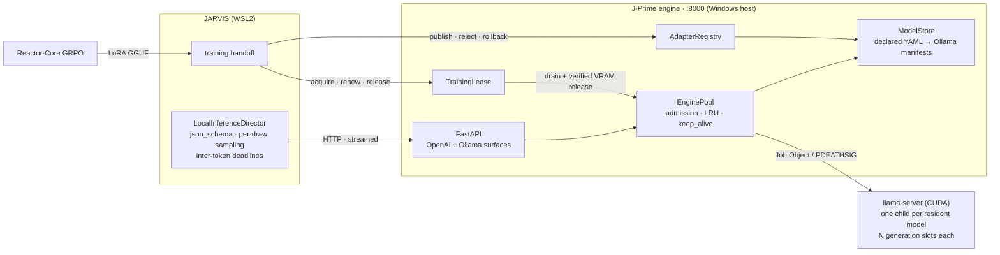

# J-Prime

**The local inference serving tier of the Trinity autonomous multi-agent OS. It serves a 30B MoE coder at a p50 of 172 tok/s single-stream decode on one RTX 5090, at zero marginal cost per request, behind admission control, an exclusive training lease, and a verified hot-swap LoRA registry.**

J-Prime is one of three repositories, all solo-architected by [Derek J. Russell](https://github.com/drussell23), with about **5.9M tracked lines** (4.16M Python), **11,400+ commits** and **68,000+ `def test_` functions** across the three (generated figures: the [JARVIS README](https://github.com/drussell23/JARVIS)).

| Repository | Tier | Role |
|---|---|---|
| [**JARVIS**](https://github.com/drussell23/JARVIS) | Agent OS / control plane | The Ouroboros + Venom (O+V) autonomous engineering pipeline. Its 2,700-line `LocalInferenceDirector` is J-Prime's primary client. |
| **J-Prime** (this repo) | Inference serving | Model lifecycle, VRAM admission, protocol translation, training lease, adapter registry |
| [**Reactor-Core**](https://github.com/drussell23/JARVIS-Reactor) | Training | GRPO LoRA fine-tuning of the served model on JARVIS's own verified commits |

---

## At a glance

| | |
|---|---|
| Decode throughput, single slot | **p50 172 tok/s** (p10 152, p90 184; n = 337 generations, predominantly real O+V traffic; `--parallel 1`, 2026-10-07) |
| Prefill, 4k–8k uncached tokens | **p50 885 ms** (~6.5k tok/s; ≈ time to first token) |
| Cold load, 30B + LoRA | **15 s** to resident, 18.9 GiB |
| Marginal cost per request | **$0.00** (no API metering) |
| GPU hand-off to training | **21,236 MiB** released and verified before the trainer starts |
| Engine core | `jarvis_prime/engine/`: 11 modules, ~2,400 lines; no torch and no llama-cpp-python in-process |

Methodology, hardware, and caveats: [`BENCHMARKS.md`](BENCHMARKS.md).

---

## System topology



J-Prime handles lifecycle, admission, and protocol, while llama.cpp does the inference. The engine imports nothing from the rest of `jarvis_prime`, so it can't inherit the dependency weight of the legacy stack.

---

## Components

| Module | Lines | Responsibility |
|---|---|---|
| `engine/engine_pool.py` | 594 | One `llama-server` per resident model, launched with N **generation slots** (`--parallel N`, each slot holding a full `ctx` of KV). Slots default to `auto`: sized at load from free VRAM (plus what idle engines could release) and the model's KV geometry, clamped to `JPRIME_ENGINE_PARALLEL_MAX`; an unreadable card or unknown geometry means one slot. VRAM admission uses the **measured** footprint per (model, ctx, slots) once known, falling back to weights + KV(ctx) × slots + 512 MiB. Also handles LRU eviction of idle engines (busy engines are never evicted), pinning, Ollama-semantics `keep_alive`, context-growth reloads, reload when an adapter changes, and orphan reaping after a hard kill. |
| `engine/app.py` | 434 | HTTP surface, mapping errors to status codes (404 / 409 / 422 / 503 + `Retry-After`), the lease gate, and evaluation scopes |
| `engine/protocol.py` | 278 | Ollama ↔ OpenAI translation: `format` → `json_schema` (strict), tool-call conversion in both directions, SSE → NDJSON stream translation, and usage/timing fields filled from llama.cpp timings |
| `engine/lease.py` | 271 | Exclusive training lease: `SERVING → DRAINING → RELEASED → RESTORING` |
| `engine/adapter_registry.py` | 260 | Versioned LoRA publish / validate / activate / rollback / reject, and verified model declaration |
| `engine/model_store.py` | 262 | Name → files resolution. Declared `models.yaml` first, then Ollama manifests read **in place** (base, LoRA layers, projector, params) with no Ollama daemon required |
| `engine/gguf_meta.py` | 114 | Reads the GGUF header without loading tensors; KV bytes/token derived from model geometry |
| `engine/gpu.py` · `declare.py` · `__main__.py` | 178 | `nvidia-smi` probe, model-declaration CLI, server entry point |

### Guarantees

- **No out-of-memory surprises.** A load is admitted only if free VRAM covers the need plus headroom. Loads are serialized so each VRAM change can be credited to the load that caused it, and a reading below 0.9 × the weight size is rejected as unreliable. If nothing can be evicted, the caller gets `503` with the reason.
- **No orphaned GPU processes.** On Windows, child servers live in a Job Object with `KILL_ON_JOB_CLOSE`; on Linux they use `setsid` + `PR_SET_PDEATHSIG`. A hard kill frees the engines' VRAM; PIDs are persisted and orphans are reaped on restart.
- **The trainer never shares the card with inference.** `RELEASED` is reached only after in-flight requests drain and `nvidia-smi` shows the engines' memory actually returned. While the lease is held, generations get `503 + Retry-After`. An expired lease restores service only if VRAM admission passes, so an outliving trainer is never pushed out of memory.
- **A bad adapter cannot stay live.** Before activation, an adapter is checked against its own GGUF header (`general.type=adapter`, `adapter.type=lora`, an architecture matching the base) and its sha256. Activation rewrites `models.yaml` atomically. `reject` deletes only registry-owned files, keeps an audit record, and restores the last good version. The original adapter set (`origin`) can never be deleted.
- **Reproducible evaluation.** `POST /v1/models/{name}/evaluation` disables `cache_prompt` for a bounded TTL. With the cache on, greedy outputs differed; with it off, they were 3/3 byte-identical. This makes baseline-vs-candidate adapter comparisons meaningful.

---

## API

| Surface | Routes |
|---|---|
| OpenAI | `POST /v1/chat/completions` · `POST /v1/completions` · `GET /v1/models` |
| Ollama-compatible | `POST /api/chat` · `POST /api/generate` · `GET /api/tags` · `GET /api/ps` (reports each resident model's slot count as `parallel`) · `POST /api/show` · `GET /api/version` |
| Operations | `GET /health` · `POST /v1/models/{name}/evaluation` · `POST /v1/models/{name}/unload` |
| Training lease | `GET /v1/lease` · `POST /v1/lease/{acquire,renew,release}` |
| Adapters | `GET /v1/adapters/{name}` · `POST /v1/adapters/{name}/{publish,activate,rollback,reject}` |

`response_format` (`json_schema` / `json_object`), `tools`, streaming, and `stream_options.include_usage` pass through on the OpenAI surface and are translated on the Ollama surface. `num_ctx` and `keep_alive` are consumed by the engine and never forwarded.

> **Security:** the engine binds `127.0.0.1` by default and has **no authentication**. Lease and adapter routes accept any caller that can reach the port, so do not expose it beyond loopback.

---

## Local setup

**Requirements:** an NVIDIA GPU with `nvidia-smi` on `PATH` (the reference host is an RTX 5090, 32 GB), a CUDA build of llama.cpp `llama-server`, Python 3.11, and [`uv`](https://github.com/astral-sh/uv).

**1. Install a llama.cpp build.** The engine resolves `JPRIME_LLAMA_SERVER_BIN`, or else the newest `<engine home>/llama.cpp/<build>/llama-server[.exe]`. The engine home is `%LOCALAPPDATA%\JARVIS\jprime\engines` on Windows and `$XDG_DATA_HOME/jarvis/jprime/engines` on Linux. The reference host runs b11462, win-cuda-13.4-x64.

**2. Start the engine.**

```powershell
# Windows: creates .venv-engine on first run, starts detached (reachable from WSL), waits for health
scripts\engine\jprime_engine.ps1 -Action start -Preload qwen3-coder-ov:30b   # -Ctx 32768 by default; -Parallel N|auto
scripts\engine\jprime_engine.ps1 -Action status      # exit 3 if not serving
scripts\engine\jprime_engine.ps1 -Action stop
```

```bash
# Any OS
pip install fastapi uvicorn httpx pyyaml psutil
python -m jarvis_prime.engine --port 8000 --preload qwen3-coder-ov:30b --ctx 32768 --parallel auto
```

**3. Serve a model.** Models already pulled into an Ollama store are served in place. To declare llama.cpp-format files by name, with digests verified:

```bash
python -m jarvis_prime.engine.declare --name jarvis-vision:8b \
  --model Qwen3VL-8B-Instruct-Q4_K_M.gguf --projector mmproj-Qwen3VL-8B-Instruct-F16.gguf \
  --sha256 <model-digest> --sha256 <projector-digest> --inherit-defaults
```

**4. Verify.**

```bash
curl -s http://127.0.0.1:8000/health
curl -s http://127.0.0.1:8000/v1/chat/completions -H 'content-type: application/json' \
  -d '{"model":"qwen3-coder-ov:30b","messages":[{"role":"user","content":"ping"}],"max_tokens":8}'
```

### Key configuration

| Variable | Default | Effect |
|---|---|---|
| `JPRIME_ENGINE_PORT` / `JPRIME_ENGINE_HOST` | `8000` / `127.0.0.1` | Bind address |
| `JPRIME_ENGINE_DEFAULT_CTX` / `JPRIME_ENGINE_MAX_CTX` | `8192` / `131072` | Context sizing (requests may grow it, capped at the model's native context) |
| `JPRIME_ENGINE_VRAM_HEADROOM_MIB` | `1024` | Admission headroom |
| `JPRIME_ENGINE_KEEP_ALIVE` | `5m` | Idle unload (Ollama semantics; negative = forever) |
| `JPRIME_ENGINE_PINNED` | — | Models never evicted to make room for unpinned ones |
| `JPRIME_ENGINE_PARALLEL` | `auto` | Generation slots per `llama-server`: a count, or `auto` (sized from free VRAM; one slot if the card cannot be read) |
| `JPRIME_ENGINE_PARALLEL_MAX` | `4` | Ceiling for `auto` slots |
| `JPRIME_LEASE_DRAIN_TIMEOUT_S` | `600` | Maximum wait for in-flight requests before release |
| `JPRIME_EVALUATION_TTL_S` | `3600` | Default evaluation-scope lifetime |

---

## Testing

```bash
pip install pytest fastapi httpx pyyaml psutil
pytest tests/engine
```

The engine suite (`tests/engine/test_engine.py`) has 42 test functions, 50 cases once parametrized. It covers the store, GGUF parsing, protocol translation, `keep_alive`, LRU and measured-VRAM admission, the lease state machine, adapter publish / reject / rollback, evaluation scopes, pinning, generation slots, and vision declaration. It needs **no GPU**: the launcher, health check, and GPU probe are faked.

---

## Repository layout

| Path | Status |
|---|---|
| `jarvis_prime/engine/`, `scripts/engine/`, `tests/engine/` | **Current serving path** |
| `run_server.py`, `jarvis_prime/server.py`, `jarvis_prime/core/`, `jarvis_prime/models/` | Earlier llama-cpp-python / GCP multi-model stack (pre-2026-10). Retained for reference and the `Dockerfile`; not the serving path. |
| `infra/packer/` | GCP golden-image bake (Ollama-based) |

---

## License

MIT. See [`LICENSE`](LICENSE).
